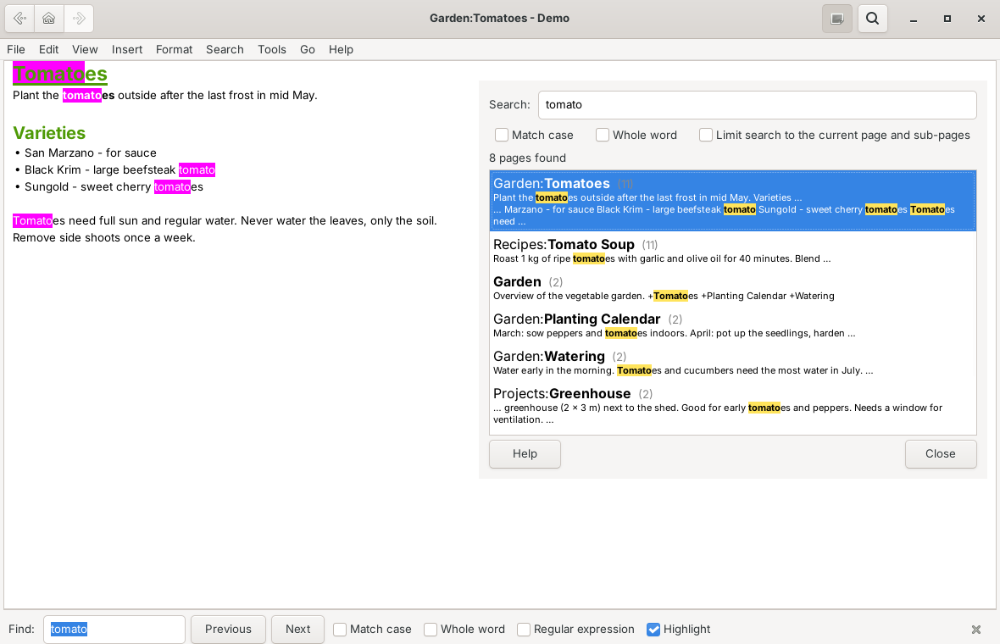
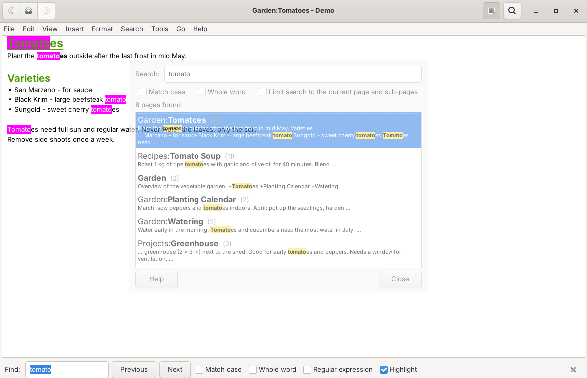

# Live Search for Zim

A plugin for [Zim Desktop Wiki](https://zim-wiki.org) that searches the whole notebook **while you type**
and shows **text snippets with the search terms highlighted** for every page found.
Click a result and the page opens with all matches highlighted.

It uses Zim's own search engine, so you get exactly the same results as with *Search › Search...*,
but instantly and with a preview of where the terms occur.

## Features

- **Search as you type** over the whole notebook, starting after a configurable number of characters
- **Snippets** with the search terms highlighted, so you see *where* a term occurs before opening a page
- **Click or arrow keys** show the page in Zim and highlight the terms; the search window stays open,
  so you can step through the results one by one
- **Double click or Enter** opens the page and closes the window (configurable)
- Same **query syntax** as the built-in search: several words (all must match), `OR`, `NOT` / `-word`,
  `"exact phrase"`, `Section:`, `Tag:`, `Name:`, `Links:` …
- Options: *Match case*, *Whole word*, *Limit search to the current page and sub-pages*
- **Adjustable transparency**: the window can be see-through while you read the page below
  and becomes fully opaque when the mouse is over it
- Remembers the last search and the options per notebook
- English and German user interface (follows the language of Zim)

## Requirements

- **Zim 0.77 or newer** (the page search was rewritten in Zim 0.77; older versions are not supported)
- Windows, Linux or macOS – the plugin is plain Python and has no further dependencies

## Installation

1. Download [`livesearch.py`](livesearch.py).
2. Copy it into the Zim plugin folder:
   - **Windows:** `%APPDATA%\zim\data\zim\plugins\`
   - **Linux:** `~/.local/share/zim/plugins/`

   Create the `plugins` folder if it does not exist yet.
3. Restart Zim.
4. Enable *Live Search* in **Edit › Preferences › Plugins**.

## Usage

Open Live Search with **Ctrl+Shift+E** or via **Tools › Live Search...** and start typing.

| Key / action | Effect |
| --- | --- |
| Typing | Searches after a short delay; typing again cancels a running search |
| Click on a result, ↑ / ↓ | Show the page and highlight the search terms |
| Double click, Enter | Open the page (and close the window, if set) |
| ↓ in the search field | Jump into the result list |
| ↑ in the first result | Back to the search field |
| Esc | Close the window |

While the window is open, Zim's find bar at the bottom of the page lets you jump from one
highlighted match to the next (*Next* / *Previous*).

The keyboard shortcut can be changed in **Edit › Preferences › Key bindings**.

## Preferences

| Setting | Default | Description |
| --- | --- | --- |
| Start searching after this number of characters | 3 | Shorter input does not start a search |
| Delay after the last keystroke (ms) | 300 | Waits until you pause typing |
| Text snippets per page | 3 | `0` shows page names only |
| Characters shown before and after a match | 45 | Length of the snippets |
| Maximum number of pages shown | 200 | Limits very broad searches |
| Close the window after double click / Enter | on | |
| Window opacity (%) | 100 | e.g. 50–70 to see the page through the window |
| Fully opaque while the mouse is over the window | on | |

Changes take effect immediately, even while the search window is open.

## Notes

- For very broad searches (e.g. a term that occurs on thousands of pages), the list shows the first
  pages found up to the configured maximum, sorted by number of matches.
  Refine the search to narrow it down.
- Snippets are created from the page text as Zim shows it, so formatting such as **bold** does not
  hide a match.

## Translations

Strings that also exist in Zim itself are translated by Zim. The plugin's own strings are
translated with a small table inside `livesearch.py` (currently German). Additional languages
can be added there – pull requests are welcome.

## License

GPL v2 or later, the same license as Zim. See [LICENSE](LICENSE).

Written by Heinz Bundschuh with the help of Claude (Anthropic).
